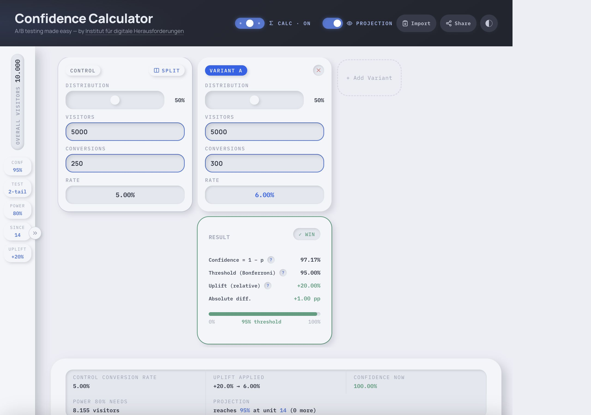
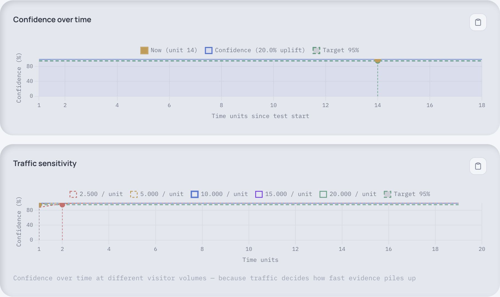
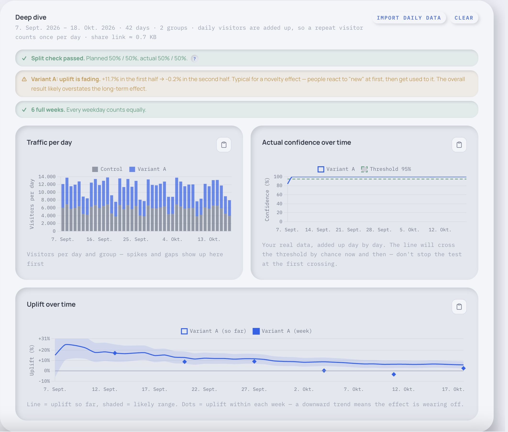

# Confidence Calculator

Compare A/B test results, see how each version is doing, and plan what to test next.

New sessions start with one control and one variant, calculation details off, and projection and deep dive hidden. Shared links retain their explicit settings. Uplift intervals use a number line with a zero marker, observed-effect point and endpoint labels; explanations are available through the `?` buttons.

[**Open the calculator →**](https://confidence.nickyreinert.de)



## What it does

- Compares visitors and conversions for your control and test versions
- Shows conversion rates, observed relative uplift, its confidence interval, p-value and significance decision together
- Separates the assumed relevant effect for power from the observed uplift
- **Example mode:** three keyboard-accessible explanations using illustrative counts, with original inputs restored on exit
- Estimates how many visitors you may need and charts your projections
- Imports data pasted from a spreadsheet or report
- Shares your test setup with a link
- **Deep dive:** paste daily numbers to see how the test developed and catch common problems
- **Quick tour:** press **?** in the header for a short walk-through

## Try sample data

Use the fictional [sample data](demo-data.csv) to try an A/B test:

1. Open the calculator and choose **Import**.
2. Copy the contents of `demo-data.csv` and paste them into the box.
3. Choose the control row if needed, then select **Apply**.

## Projections



## Deep dive

Turn on **Deep dive** in the header and import one row per group and day — e.g. an Adobe Workspace table with *Experience → Day*.



- **Checks:** split changing over time, fading effect, full weeks, traffic piling up on a few days
- **Charts:** traffic per day, actual confidence over time, uplift over time
- **Breakdowns:** weekday, day of month, month
- **Better projections:** based on the last 7, 14 or 28 days (or all days) instead of the average since the start

Try it with the fictional [daily sample data](demo-daily.csv) — a test that looks like a clear win, until the Deep dive shows the effect wearing off.

## Statistical method

Relative uplift is `variant rate / control rate - 1`; absolute difference is reported separately in percentage points. The point estimate is not a guaranteed or repeatable outcome.

The relative confidence interval inverts the two-sample score test for a rate ratio `r`. For binary outcomes, fit the nuisance control probability under `p_variant = r * p_control` by constrained maximum likelihood:

```text
B = n_control + c_variant + r * (n_variant + c_control)
p = 2 * (c_control + c_variant) /
	(B + sqrt(B^2 - 4*r*(n_control+n_variant)*(c_control+c_variant)))
V(r) = r*p*(1-r*p)/n_variant + r^2*p*(1-p)/n_control
Z(r) = (observed_variant_rate - r*observed_control_rate) / sqrt(V(r))
```

Numerical bisection locates the rate-ratio endpoints at `Z(r) = +/- normal_quantile(1-alpha/2)`; subtracting one gives relative-uplift endpoints. At `r = 1`, this is the pooled two-proportion z-test already used by the calculator. Therefore a two-sided interval excludes zero exactly when the matching test rejects at `p < alpha` (apart from floating-point tolerance at the boundary). The selected confidence level sets alpha. For multiple variants, both test and interval use Bonferroni `alpha / number_of_variants`; the interval label shows the adjusted per-comparison level, with the selected family level alongside it.

One-tailed tests are explicitly for an **increase**, selected in advance: `p = 1 - Phi(z)`, with a matching one-sided lower bound and unbounded upper endpoint. A negative observed effect is not declared a one-sided win or loss.

The existing support for conversions exceeding visitors is retained as a **Poisson event-rate** model, not a binary conversion probability. Its constrained estimate is `p = total_events / (n_control + r*n_variant)` and its variance replaces `p*(1-p)` by `p`. Both models assume independent groups and observations. These are asymptotic normal score methods, not exact coverage guarantees; sparse samples, boundary rates, clustering and overdispersed event counts require particular caution.

Zero visitors, negative counts, fractional counts and empty inputs cannot produce a result. With zero control conversions, relative uplift and its interval are explicitly undefined; the absolute difference and test remain available. With zero variant conversions and a positive baseline, uplift is -100% and the score interval has a finite upper bound, not a collapsed zero-width interval. No pseudocounts are added.

Power is an approximate normal-model planning calculation using the **separately chosen** relevant effect and the control rate as the baseline estimate. It integrates the alternative distribution beyond the matching pooled-test cutoff, including both rejection tails for a two-sided test. Bonferroni is applied to power planning too. The target power is distinct from calculated power at current sample sizes. The assumed effect defaults to +10% and is never automatically replaced with observed uplift; existing shared `scupl` values still restore unchanged.

The retained evidence-projection charts plot **1 - p**, explicitly labelled as not confidence. They are conditional scenarios, not probabilities of winning or a license to stop at a crossing. Adequate power does not establish sufficient calendar duration; plan business cycles and a stopping rule in advance.

Example mode uses control `100/1000`, variant `112/1000`, and a separate assumed effect of +20% for power. It compares that interval with variant `150/1000` against the same control. Both intervals and decisions are calculated, not hardcoded. These are distinct illustrative datasets, not a repeated-experiment simulation. Counts, variants, settings, daily data and the original URL are preserved on exit; example navigation does not overwrite the URL.

## Regression tests

Open [tests.html](tests.html) through the same static host as the calculator, or serve this directory with `python3 -m http.server 8000` and visit `http://localhost:8000/tests.html`. No build step or test dependencies are needed; the application still loads Chart.js from its existing CDN. The test page reports PASS/FAIL and sets `document.documentElement.dataset.tests` to `passed` or `failed`.

Coverage includes numerical interval regressions, confidence-level changes, swapped groups, 1,350 test/interval consistency checks (unequal samples, boundary rates, count metrics and Bonferroni), invalid/zero counts, one-sided direction, power behavior, independent planning assumptions, visible results in compact mode, example navigation, native modal/focus handling, repeated entry/exit, original variant-node restoration and exact sharing-state restoration. For responsive inspection, resize the test iframe or open the calculator at a mobile viewport and navigate Example mode with Tab, arrow keys and Escape.

**Note:** A 95% confidence method covers the fixed true effect in about 95% of newly calculated intervals over repeated experiments. It is not a 95% probability the variant wins or that today's uplift will repeat. Not significant does not establish no effect.
