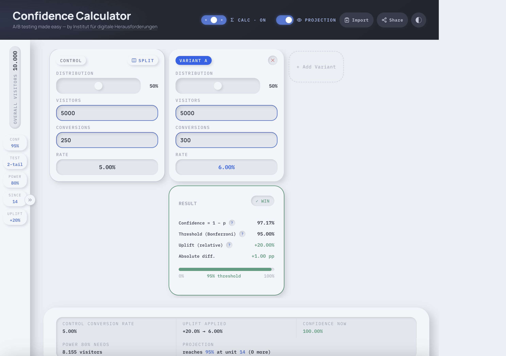
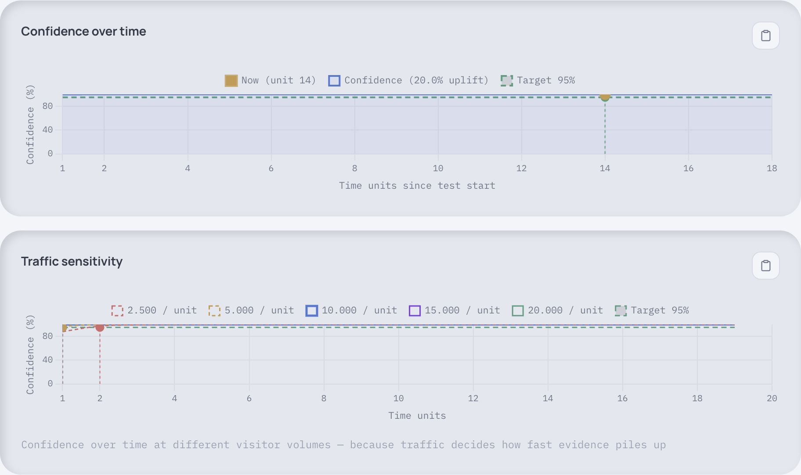
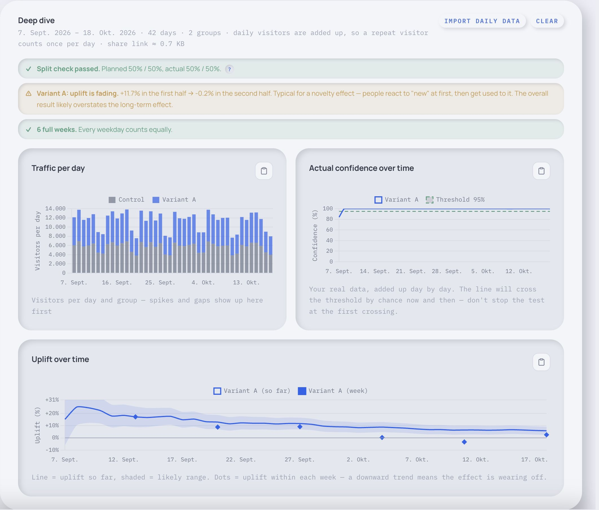

# Confidence Calculator

Compare A/B test results, see how each version is doing, and plan what to test next.

New sessions start with one control and one variant, calculation details off, and planning inputs, power charts and deep dive hidden. The p-value charts remain visible with planning off. Shared links retain their explicit settings. Uplift intervals use a number line with a zero marker, observed-effect point and endpoint labels; explanations are available through the `?` buttons.

The header controls stay visible while scrolling. Give the test a **Test name** above Overall Visitors to include it in the share URL and browser-tab title. Add `| Conversion description` after the test name to relabel the control and variant conversion fields, for example `Checkout test | Completed orders`. The new-tab button opens a clean calculator for another configuration. Names and chart-scale preferences round-trip in shared links. The tab uses a custom unicorn favicon.

Tab and Shift+Tab select the full contents of editable fields, ready to replace. Clicking a field still places the caret normally.

[**Open the calculator →**](https://confidence.nickyreinert.de)



## What it does

- Compares visitors and conversions for your control and test versions
- Explicitly selects **Binary** (default) or **Count per visitor** metrics
- Shows conversion rates, observed relative uplift, its confidence interval, p-value and significance decision together
- Separates the assumed relevant effect for power from the observed uplift
- Estimates how many visitors you may need and charts your projections
- Imports data pasted from a spreadsheet or report
- Shares your test setup with a link
- **Deep dive:** paste daily numbers to see how the test developed and catch common problems
- **Quick tour:** press **?** in the header for a short walk-through

## Try sample data

Use the fictional [sample data](demo-data.csv) to try an A/B test:

1. Open the calculator and choose **Import**.
2. Copy the contents of `demo-data.csv` and paste them into the box.
3. Choose the control row if needed, then select **Apply**.

## Projections



## Deep dive

Turn on **Deep dive** in the header and import one row per group and day - e.g. an Adobe Workspace table with *Experience → Day*.



- **Checks:** split changing over time, fading effect, full weeks, traffic piling up on a few days
- **Charts:** traffic per day, p-value over time, uplift over time
- **Breakdowns:** weekday, day of month, month
- **Better projections:** based on the last 7, 14 or 28 days (or all days) instead of the average since the start

Try it with the fictional [daily sample data](demo-daily.csv) - a test that looks like a clear win, until the Deep dive shows the effect wearing off.

## Statistical method

Relative uplift is `variant mean / control mean - 1`; absolute difference is reported separately in percentage points. The point estimate is not a guaranteed or repeatable outcome.

For binary outcomes, the relative confidence interval inverts the two-sample score test for a rate ratio `r`. Fit the nuisance control probability under `p_variant = r * p_control` by constrained maximum likelihood:

```text
B = n_control + c_variant + r * (n_variant + c_control)
p = 2 * (c_control + c_variant) /
	(B + sqrt(B^2 - 4*r*(n_control+n_variant)*(c_control+c_variant)))
V(r) = r*p*(1-r*p)/n_variant + r^2*p*(1-p)/n_control
Z(r) = (observed_variant_rate - r*observed_control_rate) / sqrt(V(r))
```

Numerical bisection locates the rate-ratio endpoints at `Z(r) = +/- normal_quantile(1-alpha/2)`; subtracting one gives relative-uplift endpoints. At `r = 1`, this is the pooled two-proportion z-test already used by the calculator. Therefore a two-sided interval excludes zero exactly when the matching test rejects at `p < alpha` (apart from floating-point tolerance at the boundary). The selected confidence level sets alpha. For multiple variants, both test and interval use Bonferroni `alpha / number_of_variants`; the interval label shows the adjusted per-comparison level, with the selected family level alongside it.

The multiple-variant notice shows the selected confidence exactly as labelled in the sidebar, without trailing zeros. It explains the stricter interval level separately: selecting **99.99%** with two variants uses **99.995%** per interval, while selecting **99.999%** uses **99.9995%**. The sidebar selection stays unchanged. Adjusted percentages are rounded to at most five decimal places without padding.

One-tailed tests are explicitly for an **increase**, selected in advance: `p = 1 - Phi(z)`, with a matching one-sided lower bound and unbounded upper endpoint. A negative observed effect is not declared a one-sided win or loss.

**Binary** is the default and requires conversions not to exceed visitors. Such input produces an explicit error; the calculator never silently changes models.

For **Count per visitor** metrics, the observed mean is `conversions / visitors`. Enter one shared standard deviation across all visitors; its square is used as each group's visitor-level variance. The variance of a group mean is `s² / n`, and the mean-comparison standard error is `sqrt(s²/n_control + s²/n_variant)`. The relative-uplift interval uses the delta-method variance for the ratio `r = mean_variant / mean_control`:

```text
Var(r) ≈ r² · (s²/(n_control·mean_control²) +
               s²/(n_variant·mean_variant²))
```

The interval is `r ± z*sqrt(Var(r))`, converted to uplift by subtracting one. Without a valid SD, count mode blocks p-values, intervals, power, projections and deep-dive results; there is no Poisson fallback. Use the SD helper to paste one non-negative whole-number conversion count per visitor for the entire test. It checks that the row count matches total visitors and the sum matches total conversions, then calculates the sample SD with `n − 1`. The SD is itself an estimate. Aggregate spreadsheet imports select count mode but cannot provide visitor-level SD, so results remain blocked until an SD is entered or calculated. Shared links use the `sd` parameter; legacy `disp` values are ignored and surfaced with a notice. Both modes assume independent visitors and groups; sparse samples, zero means and correlated observations require caution.

Zero visitors, negative counts, fractional counts and empty inputs cannot produce a result. With zero control conversions, relative uplift and its interval are explicitly undefined; the absolute difference and test remain available. In binary mode, zero variant conversions and a positive baseline give -100% uplift and a score interval with a finite upper bound, not a collapsed zero-width interval. A count-mode delta interval can be unavailable at a zero variant mean when no positive SD is supplied. No pseudocounts are added.

Power is an approximate normal-model planning calculation using the **separately chosen** relevant effect and the control mean as the baseline estimate. Binary power integrates the alternative distribution beyond the pooled-test cutoff; count power uses the shared SD and an unpooled mean-difference cutoff. Both include the appropriate rejection tails and apply Bonferroni to power planning. The target power is distinct from calculated power at current sample sizes. The assumed effect defaults to +10% and is never automatically replaced with observed uplift; existing shared `scupl` values still restore unchanged.

Projection and daily-history charts consistently plot **p-value**, with a synchronized **Linear / Logarithmic** switch beside each p-value chart's copy button (linear by default). Lower means stronger evidence against no effect. Logarithmic charts floor values below 0.000001 for plotting only; tooltips retain the below-limit label. Projections are conditional scenarios, not probabilities of winning or a license to stop at a crossing. Adequate power does not establish sufficient calendar duration; plan business cycles and a stopping rule in advance.

Very small p-values display as **< 0.000001**, never a rounded zero or scientific notation. Normal tail probabilities are evaluated directly, avoiding cancellation from subtracting a near-one CDF. Decisions use the unrounded p-value. The **significance level (alpha)** is set by the selected confidence level and adjusted for multiple variants; it is not the measured p-value. All related statistical help panels and tooltips start with this relationship: for one variant, 95% confidence sets alpha to 0.05 (5%), and a measured p-value below alpha is statistically significant. Confidence is a setting, not 1 minus the p-value or a probability of winning.

## Regression tests

Open [tests.html](tests.html) through the same static host as the calculator, or serve this directory with `python3 -m http.server 8000` and visit `http://localhost:8000/tests.html`. No build step or test dependencies are needed; the application still loads Chart.js from its existing CDN. The test page reports PASS/FAIL and sets `document.documentElement.dataset.tests` to `passed` or `failed`.

Coverage includes numerical binary interval regressions, shared count-mode variance and delta-method cases, missing-SD blocking, visitor-table validation, URL round trips for metric/shared SD inputs, legacy `disp` handling, binary overflow validation, confidence-level changes, unequal samples, Bonferroni, invalid/zero counts, one-sided direction, power and projection behavior, independent planning assumptions, visible results in compact mode, connection-first statistical help, Tab selection without changing pointer behavior, fresh-start defaults, tiny-p-value precision and display, the integrated linear/log switch across charts, compact projection summaries and named shared-link round trips. For responsive inspection, resize the test iframe or open the calculator at a mobile viewport.

**Note:** A 95% confidence method covers the fixed true effect in about 95% of newly calculated intervals over repeated experiments. It is not a 95% probability the variant wins or that today's uplift will repeat. Not significant does not establish no effect.
